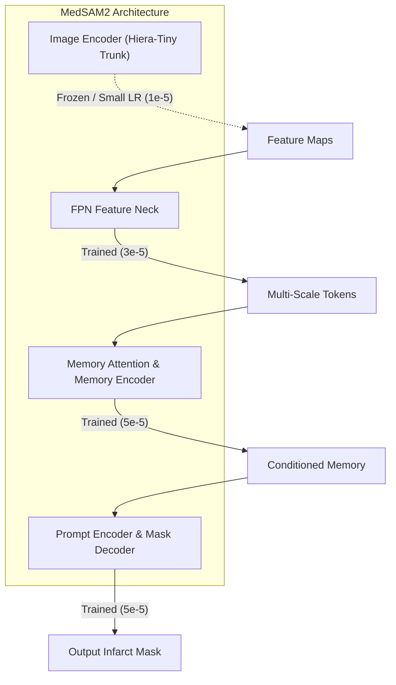
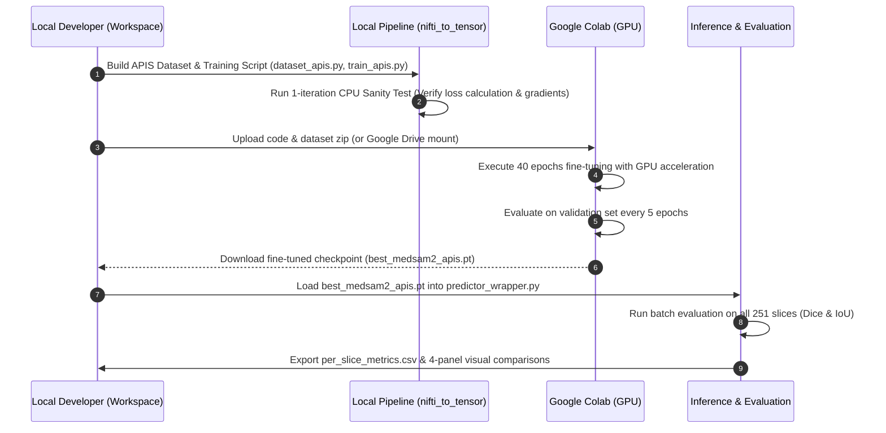

# MedSAM2 Fine-Tuning Implementation Plan: APIS Brain Infarct Segmentation

This document details the complete technical design, engineering workflow, loss formulation, and execution strategy for fine-tuning **MedSAM2** specifically on the **APIS Brain CT Infarct Dataset**.

---

## 1. Executive Summary & Objective

* **Objective:** Adapt the general-lesion MedSAM2 model to specialize in ischemic brain stroke hypodensity boundary delineation ($0 - 80$ HU Brain Window) using ground-truth-derived bounding box prompts.
* **Initialization:** Pretrained weights `MedSAM2_CTLesion.pt` (38.96M parameters) are used exclusively for model initialization.
* **Target Outcome:** Export a fine-tuned checkpoint (`best_medsam2_apis.pt`) that replaces the pretrained weights for subsequent infarct segmentation inference, improving boundary sharpness and Dice/IoU scores on multi-component and subtle stroke lesions.
* **Dataset Constraints:** `APIS_Dataset/` remains 100% read-only. Existing verified conversion scripts (`nifti_to_tensor.py` and `box_parser.py`) are directly reused.

---

## 2. Environment Assessment: Local CPU vs. Google Colab

### 2.1 Hardware Reality Check
| Metric | Local Machine (Current) | Google Colab (Free T4 / Pro A100 GPU) |
| :--- | :--- | :--- |
| **Compute Device** | Intel CPU (CUDA currently unavailable) | NVIDIA T4 (16 GB) / A100 (40 GB) |
| **Forward Pass (1 Slice)** | $\approx 2.5 - 4.0\text{ seconds}$ | $\approx 15 - 25\text{ milliseconds}$ |
| **Backward Pass (Gradient Calc)** | $\approx 6.0 - 10.0\text{ seconds}$ | $\approx 35 - 50\text{ milliseconds}$ |
| **1 Training Epoch (40 patients)** | $\approx 35 - 50\text{ minutes}$ | $\approx 45 - 75\text{ seconds}$ |
| **Full Training (40 Epochs)** | **$\approx 24 - 33\text{ hours}$** | **$\approx 30 - 45\text{ minutes}$** |

### 2.2 Recommendation: Hybrid Execution Strategy
**Yes, it is substantially better and strongly recommended to use Google Colab for the backpropagation training loop.**

* **What we do locally in this repository:**
  1. Prepare the self-contained dataset loader (`dataset_apis.py`) reusing `nifti_to_tensor.py` and `box_parser.py`.
  2. Implement and locally verify the training script (`train_apis.py`) using a single-batch CPU sanity test.
  3. Package the dataset and scripts into a clean, one-click Google Colab notebook (`finetune_medsam2_colab.ipynb`).
  4. Perform final multi-slice batch evaluation and visualization locally once the fine-tuned weights return.
* **What runs in Google Colab:**
  * The intensive multi-epoch forward-backward training loop with CUDA GPU acceleration, saving `best_medsam2_apis.pt`.

---

## 3. Architecture & Parameter Training Strategy

MedSAM2 consists of three primary modules. To achieve maximum convergence speed and prevent catastrophic forgetting on medical CT features, we adopt a **targeted fine-tuning strategy**:

1. **Image Encoder Trunk (`Hiera-Tiny`)**:
   * *Status:* Frozen for initial epochs, or trained with a very low learning rate ($\eta = 1 \times 10^{-5}$) and layer decay ($0.9$).
   * *Reason:* MedSAM2's pretrained Hiera backbone already extracts robust multi-scale CT image representations. Freezing or gently fine-tuning prevents gradient instability.
2. **FPN Neck & Memory Attention**:
   * *Status:* **Trainable** ($\eta = 3 \times 10^{-5}$).
   * *Reason:* Adapts inter-slice spatial continuity and slice-to-slice memory propagation across axial CT scans.
3. **Two-Way Transformer Mask Decoder**:
   * *Status:* **Fully Trainable** ($\eta = 5 \times 10^{-5}$).
   * *Reason:* Crucial for learning the specific attenuation boundaries of ischemic hypodensity in brain parenchyma ($20 - 40$ HU).

---

## 4. Dataset Pipeline & Bounding-Box Prompt Integration

### 4.1 Reusing Existing Verified Modules
The training dataset loader will directly import and execute:
* [`load_apis_nifti_volume`](file:///d:/BITS/acads/4-1/SOP_AI_Enabler%20Stroke%20detector/Code%20files/MEDSAM%20for%20infarct/nifti_to_tensor/nifti_to_tensor.py): Ingests `.nii.gz` volumes, calibrated HU.
* [`apply_hu_windowing`](file:///d:/BITS/acads/4-1/SOP_AI_Enabler%20Stroke%20detector/Code%20files/MEDSAM%20for%20infarct/nifti_to_tensor/nifti_to_tensor.py): Maps $[0.0, 80.0]$ HU Brain Window $\rightarrow [0, 255]$ uint8.
* [`ct_volume_to_medsam2_tensor`](file:///d:/BITS/acads/4-1/SOP_AI_Enabler%20Stroke%20detector/Code%20files/MEDSAM%20for%20infarct/nifti_to_tensor/nifti_to_tensor.py): Produces the normalized `(D, 3, 512, 512)` PyTorch tensor.
* [`parse_yolo_label_file`](file:///d:/BITS/acads/4-1/SOP_AI_Enabler%20Stroke%20detector/Code%20files/MEDSAM%20for%20infarct/bbox_format/box_parser.py): Parses bounding box coordinates in pixel bounds $[0, 512]$.

### 4.2 Training Split & Positive Slice Targeting
* **Train Set (40 patients):** $\approx 200$ positive slices.
* **Validation Set (10 patients):** $33$ positive slices.
* **Test Set (10 patients):** $18$ positive slices (held out strictly for final evaluation).

### 4.3 Prompt Simulation & Jittering
During training, prompts are generated directly from the ground-truth annotations with random jitter:
* **Base Box:** Derived from Phase 1 label files or mask bounding box $[x_{\min}, y_{\min}, x_{\max}, y_{\max}]$.
* **Bounding Box Noise:** Add Gaussian coordinate shift ($\pm 5 - 10\%$ of width and height, clamped to $[0, 512]$). This ensures the fine-tuned model is resilient to detector inaccuracies.

---

## 5. Loss Formulation & Optimization Details

### 5.1 Multi-Task Compound Loss
Because ischemic stroke lesions occupy a very small fraction of the 3D brain scan ($< 2\%$), standard cross-entropy alone suffers from severe class imbalance. We optimize:

$$\mathcal{L}_{\text{total}} = 20.0 \cdot \mathcal{L}_{\text{mask}} + 1.0 \cdot \mathcal{L}_{\text{Dice}} + 1.0 \cdot \mathcal{L}_{\text{IoU}}$$

1. **Mask Logit Loss ($\mathcal{L}_{\text{mask}}$)**:
   * Binary Cross-Entropy with Logits (or Focal Loss) weighted over foreground lesion pixels.
2. **Soft Dice Loss ($\mathcal{L}_{\text{Dice}}$)**:
   $$\mathcal{L}_{\text{Dice}} = 1 - \frac{2 \sum_{i} p_i g_i + \epsilon}{\sum_{i} p_i^2 + \sum_{i} g_i^2 + \epsilon}$$
   Directly optimizes volumetric overlap and sharpens stroke edges.
3. **IoU Prediction Loss ($\mathcal{L}_{\text{IoU}}$)**:
   * Smooth L1 / MSE loss supervising MedSAM2's internal IoU head against the true Dice overlap.

### 5.2 Optimizer & Hyperparameters
* **Optimizer:** `torch.optim.AdamW`
* **Weight Decay:** $0.1$ (excluding biases and LayerNorm)
* **Gradient Clipping:** `max_norm = 0.1` (prevents attention gradient spikes)
* **Precision:** `torch.amp.autocast(dtype=torch.bfloat16)` on GPU
* **Epochs:** 40 epochs
* **Batch Size:** 2 patients per batch (or 8 positive slices per step)
* **Learning Rate Schedule:** Cosine Annealing starting at $5 \times 10^{-5}$ decaying to $5 \times 10^{-6}$.

---

## 6. Detailed Step-by-Step Implementation Workflow

### Step 1: Create the PyTorch APIS Dataset Loader (`training/dataset_apis.py`)
* Implements `APISDataset(torch.utils.data.Dataset)`.
* Ingests NIfTI volumes using `load_apis_nifti_volume()`.
* Applies brain windowing $[0, 80]$ HU and converts to tensor `(D, 3, 512, 512)`.
* Loads ground-truth masks `_r1_mask.nii.gz` and Phase 1 box labels.

### Step 2: Create the Fine-Tuning Script (`training/train_apis.py`)
* Initializes model with `MedSAM2_CTLesion.pt`.
* Sets up AdamW, compound loss (BCE + Dice + IoU), and Cosine Annealing.
* Includes validation loop evaluating mean Dice after each epoch.
* Automatically checkpoints `best_medsam2_apis.pt`.

### Step 3: Run Local Sanity Test (1 Iteration)
* Execute a single forward/backward pass locally to verify:
  * Gradients flow through all un-frozen layers.
  * Loss computes without NaN or shape mismatch.
  * Checkpoint saving and reloading functions properly.

### Step 4: Create Self-Contained Google Colab Notebook (`finetune_medsam2_colab.ipynb`)
* Provides an all-in-one notebook:
  1. Clones/copies the local codebase.
  2. Sets up GPU environment (`torch`, `hydra-core`, `nibabel`).
  3. Mounts Google Drive or unzips dataset.
  4. Runs full 40-epoch training in $\approx 30$ minutes.
  5. Automatically exports and downloads `best_medsam2_apis.pt`.

### Step 5: Inference & Full Batch Evaluation
* Place `best_medsam2_apis.pt` into `MEDSAM for infarct/checkpoints/finetuned/`.
* Run batch inference across all 251 confirmed positive slices in APIS.
* Compare fine-tuned vs. pretrained baseline across:
  * Single focal lesions (`train_008`, `train_001`).
  * Multi-component lesions (`train_014`).
* Export `summary_metrics.json` and `per_slice_metrics.csv`.

---

## 7. Deliverables & Expected Outcomes

| Artifact | File Path | Purpose |
| :--- | :--- | :--- |
| **Fine-Tuning Dataset Loader** | `MEDSAM for infarct/training/dataset_apis.py` | PyTorch dataset loading NIfTI tensors and masks |
| **Fine-Tuning Trainer** | `MEDSAM for infarct/training/train_apis.py` | Complete training loop with Dice + BCE + IoU loss |
| **Google Colab Notebook** | `MEDSAM for infarct/finetune_medsam2_colab.ipynb` | One-click GPU training runner |
| **Fine-Tuned Checkpoint** | `MEDSAM for infarct/checkpoints/finetuned/best_medsam2_apis.pt` | Specialized brain infarct MedSAM2 weights |
| **Evaluation Metrics** | `MEDSAM for infarct/outputs/finetuned_eval/per_slice_metrics.csv` | Full 251-slice Dice & IoU comparison |

