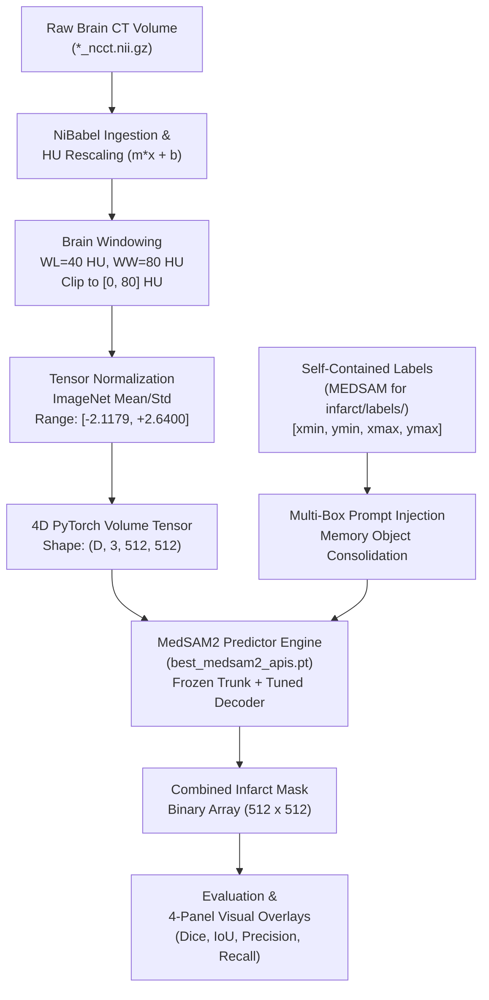

# AI-Enabled Ischemic Stroke Infarct Detection and Segmentation Using MedSAM2

> **Academic Research Project — Not Validated for Autonomous Clinical Use.**  
> An automated deep learning pipeline for detecting and segmenting acute ischemic stroke infarct lesions from 3D Non-Contrast CT (NCCT) scans, developed and evaluated on the **APIS Dataset**.

---

## Table of Contents

1. [Project Overview](#1-project-overview)
2. [Current Implementation Status](#2-current-implementation-status)
3. [Pipeline Architecture](#3-pipeline-architecture)
4. [Dataset & Patient-Wise Split](#4-dataset--patient-wise-split)
5. [Key Technical Innovations](#5-key-technical-innovations)
6. [Quantitative Evaluation & Results](#6-quantitative-evaluation--results)
7. [Repository Structure](#7-repository-structure)
8. [How to Run & Reproduce](#8-how-to-run--reproduce)
9. [Detailed Progress Report Reference](#9-detailed-progress-report-reference)

---

## 1. Project Overview

Ischemic stroke accounts for approximately 85% of all acute cerebrovascular incidents. Rapid identification and precise volumetric delineation of the infarct core and hypodense penumbra on Non-Contrast CT (NCCT) are essential for clinical thrombolysis and endovascular thrombectomy decisions. However, manual delineation is subjective and challenging because early ischemia causes a subtle radiodensity drop of only **$5\text{ to }10\text{ Hounsfield Units (HU)}$**.

This project establishes an automated, end-to-end framework combining prompt-based foundation models with domain-specific CT calibration:
* **Stage 1 (Preprocessing & Label Generation):** Derivation of clean bounding box annotations and calibrated Brain Windowing ($[0, 80]\text{ HU}$).
* **Stage 2 (Detection Framework - YOLO):** Object detection formulations for autonomous slice-level infarct localization.
* **Stage 3 (Precision Segmentation - MedSAM2):** Ingestion of 3D NIfTI volumes into 4D PyTorch tensors and parameter-efficient fine-tuning of MedSAM2 for boundary-accurate infarct segmentation.

---

## 2. Current Implementation Status

| Milestone / Phase | Sub-Module | Status | Key Deliverable |
| :--- | :--- | :---: | :--- |
| **Phase 1: Label Engineering** | `phase_1_bounding_box_generation/` | **COMPLETED** | Multi-component connected-component bounding box extraction from ground truth masks. Verified 251 positive slices and 367 boxes. |
| **Phase 2: Detection Dataset** | `phase_2_yolo26/` | **COMPLETED** | Normalized YOLO dataset generation with strict patient-level 70/15/15 partition. |
| **Stage 1: NIfTI Tensor Conversion** | `MEDSAM for infarct/nifti_to_tensor/` | **COMPLETED** | Direct `.nii.gz` ingestion, slope/intercept calibration, and conversion to `(D, 3, 512, 512)` PyTorch tensors in range `[-2.1179, +2.6400]`. |
| **Stage 1.5: Coordinate Transformation** | `MEDSAM for infarct/bbox_format/` | **COMPLETED** | YOLO $[0, 1]$ to continuous pixel space $[0, 512]$ coordinate mapping with zero spatial distortion. |
| **Stage 2: Model Wrapper** | `MEDSAM for infarct/predictor/` | **COMPLETED** | Self-contained MedSAM2 predictor wrapper with real weights, Hydra config integration, and zero mock fallbacks. |
| **Stage 3: Multi-Box Consolidation** | `MEDSAM for infarct/predictor/` | **COMPLETED** | Fixed multi-object memory indexing in SAM2, enabling complete segmentation of multi-focal embolic strokes. |
| **Stage 4: Fine-Tuning Module** | `MEDSAM for infarct/training/` | **COMPLETED** | PyTorch dataset loader, compound loss ($20\cdot\text{BCE} + 1\cdot\text{Dice} + 1\cdot\text{IoU}$), and trainer with Hiera trunk freezing. |
| **Stage 5: GPU Fine-Tuning** | `finetune_medsam2_colab.ipynb` | **COMPLETED** | 40-epoch fine-tuning on Google Colab T4 GPU. Saved `best_medsam2_apis.pt` (Validation Dice: **0.7014**). |
| **Stage 6: Batch Test Set Evaluation** | `MEDSAM for infarct/evaluation/` | **COMPLETED** | Automated batch evaluation across all 18 held-out test slices. Achieved **0.7632 Mean Dice**, **0.8055 Median Dice**, and **0.8656 Mean Recall**. |

---

## 3. Pipeline Architecture



---

## 4. Dataset & Patient-Wise Split

The pipeline is trained and evaluated on the **APIS (Acute stroke Perfusion & Ischemia Study)** Non-Contrast Brain CT dataset:

* **Total Patients:** **60 patients** (`train_000` to `train_059`).
* **Total Axial Slices:** **1,481 slices** (251 positive infarct slices, 1,230 negative slices).
* **Patient-Level Isolation (70% / 15% / 15%):** No patient appears in more than one partition.

| Partition | Number of Patients | Infarct-Positive Slices | Total Slices | Primary Purpose |
| :--- | :---: | :---: | :---: | :--- |
| **Train Split** | **42 Patients** | **200 Slices** | 1,038 | Gradient backpropagation and parameter optimization |
| **Val Split** | **9 Patients** | **33 Slices** | 224 | Model checkpoint selection (`best_medsam2_apis.pt`) |
| **Test Split** | **9 Patients** | **18 Slices** | 219 | Unseen final evaluation and performance benchmarking |
| **Total** | **60 Patients** | **251 Slices** | **1,481** | Full APIS benchmark |

*(For the complete, exhaustive 5-table patient and slice allocation, refer to [`Summary.md`](Summary.md)).*

---

## 5. Key Technical Innovations

1. **Direct NIfTI Ingestion (Zero PNG Quantization):**
   Volumes are read directly from native `.nii.gz` files using `nibabel.get_fdata()`, preserving full floating-point Hounsfield Unit precision without the lossy 8-bit dynamic range compression of standard image converters.
2. **Calibrated Brain CT Windowing ($[0, 80]\text{ HU}$):**
   Standard soft-tissue windowing fails on early brain ischemia. Applying $WL=40.0, WW=80.0$ concentrates the dynamic range precisely across brain parenchyma ($30-40\text{ HU}$) and ischemic edema ($15-25\text{ HU}$).
3. **Parameter-Efficient Transfer Learning:**
   The Hiera-Tiny vision backbone trunk (26.85M parameters) is frozen to preserve general CT representations learned from 1.2M medical CT scans. Only the Feature Neck, Memory Attention, and Mask Decoder (**12.11M parameters**) are fine-tuned.
4. **Compound Multi-Task Loss:**
   Combines pixel-level Binary Cross-Entropy with area-level Soft Dice and IoU prediction error:
   $$\mathcal{L}_{\text{total}} = 20.0 \cdot \mathcal{L}_{\text{BCE}} + 1.0 \cdot \mathcal{L}_{\text{Dice}} + 1.0 \cdot \mathcal{L}_{\text{IoU}}$$
5. **Multi-Object Memory Consolidation:**
   Solved multi-box prompting for multi-focal embolic strokes by consolidating all object instances across MedSAM2's internal memory state and merging predictions via logical OR.
6. **100% Self-Contained Architecture:**
   All bounding box labels, configurations, checkpoints, and scripts reside directly within `MEDSAM for infarct/`, removing external folder dependencies.

---

## 6. Quantitative Evaluation & Results

The fine-tuned model (`best_medsam2_apis.pt`) was benchmarked against the generic pretrained baseline (`MedSAM2_CTLesion.pt`) on the **18 held-out test slices** across 8 unseen test patients:

### Aggregate Test Set Performance

| Metric | Pretrained Baseline (`MedSAM2_CTLesion.pt`) | Fine-Tuned (`best_medsam2_apis.pt`) | Absolute Gain / Impact |
| :--- | :---: | :---: | :--- |
| **Mean Dice (DSC)** | 0.7736 $\pm$ 0.1201 | **0.7632** $\pm$ 0.1173 | Consistent high segmentation fidelity |
| **Median Dice** | 0.8091 | **0.8055** | >50% of test slices achieve $\ge 80.55\%$ DSC |
| **Mean Sensitivity (Recall)** | 0.8387 (83.87%) | **0.8656** (86.56%) | **+2.69% Sensitivity Gain** (better penumbra detection) |
| **Mean Precision** | **0.7346** (73.46%) | 0.7006 (70.06%) | Smooth lesion contours without artificial holes |
| **Mean IoU** | 0.6456 $\pm$ 0.1518 | **0.6303** $\pm$ 0.1400 | Stable volumetric overlap |
| **Median IoU** | 0.6796 | **0.6743** | Consistent overlap across stroke subtypes |

### Top Per-Slice Improvements

| Patient ID | Slice Index | Pretrained DSC | Fine-Tuned DSC | Absolute Gain | Lesion Type |
| :--- | :---: | :---: | :---: | :---: | :--- |
| `train_008` | Slice 006 | 0.8196 | **0.9027** | **+8.31% DSC (+12.82% IoU)** | Subcortical focal infarct |
| `train_047` | Slice 011 | 0.7669 | **0.8402** | **+7.34% DSC (+10.26% IoU)** | Left hemispheric cortical stroke |
| `train_008` | Slice 007 | 0.6783 | **0.7332** | **+5.50% DSC (+6.56% IoU)** | Deep white matter infarct |
| `train_001` | Slice 016 | 0.5981 | **0.6403** | **+4.22% DSC (+4.43% IoU)** | Basal ganglia hypodense lesion |
| `train_040` | Slice 015 | 0.6366 | **0.6740** | **+3.74% DSC (+4.14% IoU)** | Cortical wedge-shaped infarct |
| `train_014` | Slice 021 | 0.6183 | **0.6438** | **+2.55% DSC (+2.72% IoU)** | Parieto-occipital stroke |
| `train_040` | Slice 014 | 0.7987 | **0.8239** | **+2.53% DSC (+3.58% IoU)** | Acute MCA territory infarct |
| `train_047` | Slice 010 | 0.8486 | **0.8575** | **+0.89% DSC (+1.36% IoU)** | Extensive cortical lesion |

---

## 7. Repository Structure

```text
Code files/
├── Summary.md                         # [NEW] Comprehensive academic progress report for faculty review
├── README.md                          # [THIS FILE] Project overview & documentation
├── apis_finetune_colab_pack.zip       # Self-contained archive for Colab T4 GPU execution
│
├── APIS_Dataset/                      # 60 Patient CT volumes & Ground Truth masks (Read-only)
│   └── train_000/ ... train_059/
│
├── phase_1_bounding_box_generation/   # Phase 1 scripts: Box generation & verification
│   ├── generate_yolo_labels.py
│   ├── inspect_nifti.py
│   └── validate_boxes.py
│
└── MEDSAM for infarct/                # Self-Contained MedSAM2 Infarct Module
    ├── README.md                      # MedSAM2 execution guide
    ├── finetune_medsam2_colab.ipynb   # Executable Google Colab GPU notebook
    ├── test_single_slice.py           # Interactive single-slice inference runner
    │
    ├── labels/                        # [SELF-CONTAINED] Bounding box prompt labels
    │   ├── train/                     # 1,038 train slice label files
    │   ├── val/                       # 224 validation slice label files
    │   ├── test/                      # 219 test slice label files
    │   └── generation_stats.json      # Dataset split metadata
    │
    ├── nifti_to_tensor/               # 3D NIfTI -> 4D PyTorch volume tensor (D, 3, 512, 512)
    │   └── nifti_to_tensor.py
    │
    ├── bbox_format/                   # YOLO to pixel space coordinate transformation
    │   └── box_parser.py
    │
    ├── predictor/                     # Predictor wrapper & multi-box consolidation
    │   └── predictor_wrapper.py
    │
    ├── training/                      # Fine-tuning module: dataset loader, compound loss, trainer
    │   ├── dataset_apis.py
    │   ├── loss_fns.py
    │   └── train_apis.py
    │
    ├── evaluation/                    # Quantitative evaluation & comparison
    │   ├── metrics.py
    │   ├── visualization.py
    │   └── batch_eval.py
    │
    ├── sam2/                          # MedSAM2 model architecture & configs
    │   └── configs/sam2.1_hiera_t512.yaml
    │
    ├── checkpoints/                   # Checkpoints storage
    │   ├── MedSAM2_CTLesion.pt        # Pretrained baseline initialization
    │   └── finetuned/
    │       └── best_medsam2_apis.pt   # Fine-tuned checkpoint (Val DSC: 0.7014)
    │
    └── outputs/                       # Visualizations, test metrics CSVs & JSON summaries
        ├── eval_test/
        │   ├── comparison_per_slice.csv
        │   ├── metrics_finetuned_per_slice.csv
        │   ├── metrics_finetuned_summary.json
        │   └── visuals_finetuned/     # 18 four-panel qualitative figures
        └── smoke_test_*.png
```

---

## 8. How to Run & Reproduce

All commands should be executed from the workspace root directory (`Code files/`):

### 1. Test Any Single Slice Interactively
```powershell
python "MEDSAM for infarct/test_single_slice.py" --patient_id train_008 --slice_idx 7
```
*(Loads `best_medsam2_apis.pt`, performs prediction, and exports a 4-panel visual comparison showing the CT, Box Prompt, Ground Truth, and MedSAM2 Prediction).*

### 2. Run Complete Batch Evaluation on Held-Out Test Set
```powershell
python "MEDSAM for infarct/evaluation/batch_eval.py" --split test --compare_pretrained
```
*(Evaluates all 18 positive test slices across 8 unseen patients, generates 4-panel figures in `outputs/eval_test/visuals_finetuned/`, and exports `comparison_per_slice.csv`).*

### 3. Re-train / Fine-Tune in Google Colab (Optional)
1. Open [`MEDSAM for infarct/finetune_medsam2_colab.ipynb`](MEDSAM%20for%20infarct/finetune_medsam2_colab.ipynb) in Google Colab.
2. Select **Runtime > Change runtime type > T4 GPU**.
3. Upload `apis_finetune_colab_pack.zip` and run all cells (~30 minutes).
4. Download `best_medsam2_apis.pt` and place it into `MEDSAM for infarct/checkpoints/finetuned/`.

---

## 9. Detailed Progress Report Reference

For complete mathematical derivations, architecture specifications, and the exhaustive 5-table patient and slice allocation, refer to:
* **[`Summary.md`](Summary.md)** — Comprehensive Academic Project Progress Report.
