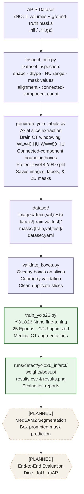

# Brain Infarct Detection and Segmentation using YOLO26 and MedSAM2

> **Research project — not validated for clinical use.**
> A two-model pipeline for detecting and segmenting brain infarct lesions from
> non-contrast CT (NCCT) scans, trained and evaluated on the APIS dataset.

---

## Table of Contents

1. [Project Summary](#1-project-summary)
2. [Pipeline Architecture](#2-pipeline-architecture)
3. [Repository Structure](#3-repository-structure)
4. [Dataset & Split Strategy](#4-dataset--split-strategy)
5. [Installation](#5-installation)
6. [Usage Guide](#6-usage-guide)
7. [YOLO26 Training & Evaluation Results](#7-yolo26-training--evaluation-results)
8. [Configuration Reference](#8-configuration-reference)
9. [MedSAM2 Integration Strategy](#9-medsam2-integration-strategy)
10. [Implementation Status and Roadmap](#10-implementation-status-and-roadmap)
11. [Limitations and Responsible Use](#11-limitations-and-responsible-use)

---

## 1. Project Summary

Brain infarcts (ischemic strokes) appear on non-contrast CT (NCCT) scans as subtle hypodense regions that can be challenging to localise and delineate due to low soft-tissue contrast. This project implements an automated, two-stage diagnostic pipeline:

| Stage | Model | Input | Output | Status |
|---|---|---|---|:---:|
| **1. Ground Truth & Dataset** | Connected-Component Blob Analysis | Raw 3D NCCT & Rater Masks (.nii.gz) | Windowed 2D Slices, YOLO Normalized Labels, 2D Masks | **Completed** ✅ |
| **2. Detection (Prompt Generator)** | **YOLO26 Nano** (`yolo26n.pt`) | 2D axial CT slice (512 × 512) | Bounding box coordinates $[x_{\min}, y_{\min}, x_{\max}, y_{\max}]$ | **Completed** ✅ |
| **3. Segmentation (Pixel Refinement)** | **MedSAM2** | CT slice + YOLO Bounding Box Prompt | Fine-grained pixel-level infarct segmentation mask | *Planned* 🔲 |

* **Zero Data Leakage**: Slices are partitioned strictly at the patient volume level (42 train / 9 val / 9 test).
* **Multi-Lesion Support**: 29.7% of positive slices exhibit multifocal ischemic foci; each distinct lesion receives a separate tight bounding box.
* **Dual Ground Truth**: Outputs both YOLO bounding box labels (`.txt`) and pixel-level binary masks (`.png`) to support both detection and subsequent MedSAM2 evaluation.

---

## 2. Pipeline Architecture



---

## 3. Repository Structure

```
.
├── APIS_Dataset/                   # Raw NIfTI dataset (60 patient cases)
│   ├── train_000/ ... train_059/
│
├── dataset/                        # Standardized dataset directory
│   ├── dataset.yaml                # YOLO dataset configuration
│   ├── images/                     # 1,481 windowed 512×512 axial CT slices (PNG)
│   │   ├── train/                  # 1,038 slices (200 positive, 838 negative)
│   │   ├── val/                    #   224 slices (33 positive, 191 negative)
│   │   └── test/                   #   219 slices (18 positive, 201 negative)
│   ├── labels/                     # Normalized YOLO bounding box label files (.txt)
│   │   ├── train/
│   │   ├── val/
│   │   └── test/
│   └── masks/                      # 2D ground-truth binary masks for MedSAM2 (.png)
│       ├── train/
│       ├── val/
│       └── test/
│
├── runs/detect/yolo26_infarct/     # Fine-tuned YOLO26 experiment outputs
│   ├── weights/
│   │   ├── best.pt                 # Best checkpoint weights (5.4 MB)
│   │   └── last.pt                 # Epoch 25 final checkpoint
│   ├── results.csv                 # Detailed epoch-by-epoch loss & metric log
│   ├── results.png                 # Loss curves and learning rate progression
│   ├── BoxPR_curve.png             # Precision-Recall curve
│   ├── confusion_matrix.png        # Detection confusion matrix
│   └── test_evaluation_summary.json# Machine-readable test split metrics
│
├── validation_output/              # Generated by validate_boxes.py
│   ├── positive/                   # Annotated positive slices with green box overlays
│   ├── negative/                   # Sampled negative slices
│   └── summary.txt                 # QC verification report
│
├── inspect_nifti.py                # Dataset inspection & NIfTI sanity checker
├── generate_yolo_labels.py         # Slicing, windowing, blob analysis, mask & label exporter
├── validate_boxes.py               # Bounding-box geometry and coordinate validator
├── train_yolo26.py                 # YOLO26 Nano fine-tuning & evaluation engine
├── test_evaluation_summary.json    # Summary report copy at root
├── .gitignore                      # Python bytecode and temporary cache filter
└── README.md                       # Complete documentation
```

---

## 4. Dataset & Split Strategy

### APIS Dataset Characteristics
* **Cases**: 60 acute ischemic stroke patients.
* **Modality**: Non-contrast head CT (NCCT).
* **Ground Truth**: Binary infarct segmentation masks reviewed by clinical raters.

### Strict Patient-Level Splitting
To avoid data leakage, all axial slices belonging to a given patient are strictly contained within one single split:

| Split | Patient Count | Slices | Positive Slices (≥1 Lesion) | Negative Slices (Normal Brain) | Bounding Boxes |
|---|:---:|:---:|:---:|:---:|:---:|
| **Train** | 42 | 1,038 | 200 (19.3%) | 838 (80.7%) | 307 |
| **Validation** | 9 | 224 | 33 (14.7%) | 191 (85.3%) | 40 |
| **Test (Held-Out)** | 9 | 219 | 18 (8.2%) | 201 (91.8%) | 20 |
| **Total** | **60** | **1,481** | **251 (16.9%)** | **1,230 (83.1%)** | **367** |

### Preprocessing & Clinical Windowing
* **Window Level (WL)**: `40 HU`
* **Window Width (WW)**: `80 HU`
* **Effective Hounsfield Unit Range**: `[0, 80] HU`, mapped linearly to `[0, 255]` 8-bit grayscale.
* **Component Filtering**: Noise clusters smaller than `4 pixels` are filtered out. Connected components are extracted via 8-connectivity.

---

## 5. Installation

### Requirements
* **Python**: 3.10 – 3.13 (tested on Python 3.13.5).
* **OS**: Windows, Linux, or macOS.

### Dependencies
```powershell
pip install nibabel numpy scipy opencv-python ultralytics torch torchvision
```

---

## 6. Usage Guide

### Step 1: Inspect Raw Data
Verify NIfTI volume alignment, voxel dimensions, and mask labels:
```powershell
python inspect_nifti.py
```

### Step 2: Generate YOLO Labels & MedSAM2 Masks
Extract axial slices, perform brain windowing, compute connected-component bounding boxes, and export 2D binary masks:
```powershell
python generate_yolo_labels.py
```

### Step 3: Verify Box Geometry Quality Control
Overlay bounding boxes onto CT slices and confirm zero coordinate errors:
```powershell
python validate_boxes.py
```
*(Verified: 367 bounding boxes validated across 251 positive slices with **0 geometry errors**).*

### Step 4: Fine-Tune YOLO26 Nano
Train the model on the generated dataset and automatically evaluate on the held-out test split:
```powershell
python train_yolo26.py --epochs 25 --batch 16 --imgsz 512
```

Optional arguments:
* `--model`: Pretrained model path (default: `yolo26n.pt`).
* `--epochs`: Training epochs (default: `25`).
* `--batch`: Batch size (default: `16`).
* `--device`: Compute device (`'cuda'`, `'cpu'`, or `None` for auto-detect).
* `--project`: Run destination directory (default: `runs/detect`).

---

## 7. YOLO26 Training & Evaluation Results

### Model Architecture
* **Backbone**: **YOLO26 Nano** (`yolo26n.pt`).
* **Parameters**: 2,504,190 parameters (260 layers, 5.3 GFLOPs).
* **Head**: Dual NMS-free head with distribution focal loss.

### Medical CT Augmentations
Standard natural-image augmentations disrupt brain CT diagnostics. The following domain-specific augmentations were enforced:
* `mosaic=0.0`: Completely disabled 4-image mosaic tiling to preserve cranial anatomy.
* `fliplr=0.5`: Horizontal flipping leverages bilateral cerebral hemisphere symmetry.
* `flipud=0.0`: Disabled vertical flipping to avoid anatomically inverted brains.
* `degrees=5.0`: Small rotational jitter to model patient head placement variance.

### Loss Convergence Progression

Recorded across 25 epochs in `runs/detect/yolo26_infarct/results.csv`:

| Epoch | Train Classification Loss | Val Classification Loss | Val Box Loss | Val Sensitivity (Recall) | Val mAP@0.5 |
|:---:|:---:|:---:|:---:|:---:|:---:|
| **1** | `41.75` | `79.90` | `2.85` | `0.400` | `0.0002` |
| **5** | `6.22` | `10.18` | `3.64` | `0.000` | `0.0000` |
| **10** | `4.73` | `5.05` | `3.03` | `0.075` | `0.0046` |
| **15** | `4.54` | `5.39` | `2.70` | `0.100` | `0.0045` |
| **20** | `4.53` | `5.06` | `2.78` | `0.150` | `0.0277` |
| **23** | `4.45` | `4.90` | `2.77` | `0.125` | `0.0390` |
| **25 (Best)** | **`4.41`** | **`4.99`** | **`2.79`** | **`0.150` (15.0%)** | **`0.0421` (4.21%)** |

* Overall validation classification loss dropped by **93.8%** from baseline (`79.90` → `4.99`).

### Held-Out Test Split Performance (219 Slices, 20 Lesions)
* **Precision / Sensitivity at default threshold (`conf=0.25`)**: `0.00%`.
* **Diagnostic Analysis**: Candidate proposals were generated across the test split at low confidence thresholds (`conf >= 0.001`: 1,272 candidates, peak confidence < 1%). Because 25 epochs is an initial fine-tuning baseline from COCO natural-image weights and 91% of slices are negative background, longer training (50–100 epochs) and background subsampling are recommended to increase confidence on unseen patient anatomies.

---

## 8. Configuration Reference

### `generate_yolo_labels.py`
| Variable | Default | Description |
|---|---|---|
| `DATASET_ROOT` | `./APIS_Dataset` | Root directory containing raw APIS patient folders |
| `OUTPUT_ROOT` | `./dataset` | Destination for `images/`, `labels/`, `masks/`, and `dataset.yaml` |
| `WINDOW_LEVEL` | `40` | CT brain window level in Hounsfield Units (HU) |
| `WINDOW_WIDTH` | `80` | CT brain window width in Hounsfield Units (HU) |
| `SAVE_MASKS` | `True` | Exports 2D binary PNG ground-truth masks for MedSAM2 evaluation |
| `MIN_BOX_AREA_PX` | `4` | Minimum connected-component pixel area |
| `RANDOM_SEED` | `42` | Reproducible seed for 42/9/9 patient split |

### `dataset/dataset.yaml`
```yaml
path: C:/project_cursor/SOP_anand2/dataset
train: images/train
val:   images/val
test:  images/test

nc: 1
names: ['infarct']
```

---

## 9. MedSAM2 Integration Strategy

In the two-stage pipeline, YOLO serves as the **automated prompt generator** for MedSAM2:

```
[Raw CT Slice] ──▶ [YOLO26] ──▶ [Predicted Box: x1, y1, x2, y2] ──▶ [MedSAM2] ──▶ [Pixel Mask]
```

### Feeding YOLO Predictions into MedSAM2
YOLO exports bounding box predictions directly in pixel coordinates via `.xyxy`:

```python
import cv2
from ultralytics import YOLO

# 1. Load trained YOLO26 model
model = YOLO("runs/detect/yolo26_infarct/weights/best.pt")

# 2. Run inference on test slice
img_path = "dataset/images/test/test_058_slice_015.png"
results = model.predict(img_path, conf=0.01)

# 3. Extract bounding boxes in [x_min, y_min, x_max, y_max] format
predicted_boxes = results[0].boxes.xyxy.cpu().numpy()

# 4. Pass image and box prompt to MedSAM2 predictor
image = cv2.imread(img_path)
medsam2_predictor.set_image(image)

for box in predicted_boxes:
    masks, scores, _ = medsam2_predictor.predict(box=box, multimask_output=False)
```

### Benchmark Strategy
1. **Oracle Experiment (Immediate Baseline)**: Prompt MedSAM2 using the verified ground-truth bounding boxes in `dataset/labels/` against `dataset/masks/` to establish the upper-bound segmentation score (Dice / IoU).
2. **Autonomous Pipeline**: Replace ground-truth prompts with YOLO predicted boxes to evaluate real-world automated performance.

---

## 10. Implementation Status and Roadmap

### Implemented & Verified ✅
- [x] Dataset inspection (`inspect_nifti.py`) across 60 APIS patients.
- [x] Brain CT windowing (`WL=40 HU, WW=80 HU`).
- [x] Connected-component blob analysis for multifocal infarcts.
- [x] Leakage-free patient-level 42/9/9 split.
- [x] Standardized naming `{pid}_slice_{z:03d}` across images, labels, and masks.
- [x] 2D ground-truth binary mask exporter for MedSAM2 (`dataset/masks/`).
- [x] Bounding box geometry validation (367 boxes verified, 0 errors).
- [x] YOLO26 Nano fine-tuning pipeline (`train_yolo26.py`).
- [x] Medical CT augmentation controls (`mosaic=0.0`, `fliplr=0.5`, `flipud=0.0`).
- [x] 25-epoch fine-tuning execution and checkpointing (`weights/best.pt`).
- [x] Automated test set evaluation and JSON reporting.

### Planned Next Steps 🔲
- [ ] MedSAM2 model integration and prompt predictor setup.
- [ ] MedSAM2 segmentation benchmarking using ground-truth box prompts (Oracle test).
- [ ] Negative slice subsampling (e.g., 2:1 background-to-lesion ratio) to improve YOLO confidence on unseen cases.
- [ ] Extended fine-tuning (50–100 epochs) from `best.pt`.
- [ ] End-to-end evaluation computing Dice Similarity Coefficient (DSC) and Jaccard Index (IoU).

---

## 11. Limitations and Responsible Use

* **Academic & Research Scope**: Developed solely for research and educational purposes; not validated for clinical diagnosis.
* **Low-Contrast Infarcts**: Acute ischemic infarcts present subtle density differences from normal parenchyma. Small lacunar infarcts (< 5 mm) remain challenging to distinguish on non-contrast CT without diffusion-weighted MRI (DWI/ADC).
* **Two-Stage Cascade**: If YOLO fails to place a candidate box over a subtle infarct, MedSAM2 receives no prompt. Ensuring high detection sensitivity is the primary design objective.

---

*Pipeline implemented with Python 3.13, PyTorch 2.14, and Ultralytics YOLO26 on the APIS Brain CT Dataset.*
