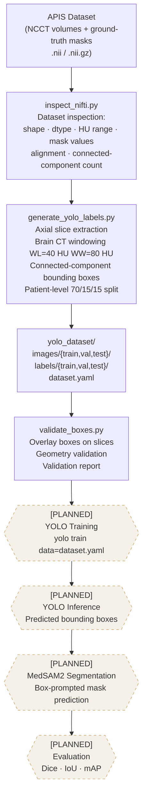

# Brain Infarct Detection and Segmentation using YOLO and MedSAM2

> **Research project — not validated for clinical use.**
> A two-model pipeline for detecting and segmenting brain infarct lesions from
> CT scans, trained and evaluated on the APIS dataset.

---

## Table of Contents

1. [Project Summary](#1-project-summary)
2. [Pipeline Architecture](#2-pipeline-architecture)
3. [Repository Structure](#3-repository-structure)
4. [Dataset](#4-dataset)
5. [Installation](#5-installation)
6. [Usage](#6-usage)
7. [Configuration Reference](#7-configuration-reference)
8. [Evaluation Metrics](#8-evaluation-metrics)
9. [Implementation Status and Roadmap](#9-implementation-status-and-roadmap)
10. [Limitations and Responsible Use](#10-limitations-and-responsible-use)

---

## 1. Project Summary

Brain infarcts (ischemic strokes) appear on non-contrast CT (NCCT) scans as
subtle hypodense regions that can be difficult to localise and delineate.
This project builds a two-stage automated pipeline:

| Stage | Model | Input | Output |
|-------|-------|-------|--------|
| Detection | **YOLO** | 2D axial CT slice | Bounding box around each infarct region |
| Segmentation | **MedSAM2** | CT slice + YOLO bounding box (as prompt) | Pixel-level infarct mask |

Ground-truth bounding boxes are derived programmatically from the APIS
dataset's manual segmentation masks and used to train YOLO.  YOLO is *not*
used to generate the training labels — it is the model being trained on them.

---

## 2. Pipeline Architecture

### Mermaid flowchart



> Solid boxes = implemented and verified.  Dashed boxes = planned.

---

### Stage 1 — Ground-Truth Label Generation ✅ Implemented & Verified

**Purpose:** Produce YOLO-format bounding-box labels from the ground-truth
infarct segmentation masks.  This stage runs entirely in Python and does
not involve any neural network.

**Inputs:**
- `APIS_Dataset/train_NNN/train_NNN_ncct.nii.gz` — NCCT CT volume
- `APIS_Dataset/train_NNN/masks/train_NNN_r1_mask.nii.gz` — binary mask
  (label `0` = background, label `1` = infarct)

**Processing steps:**

1. Load CT volume and mask with `nibabel`; verify spatial compatibility
   (matching shape, affine matrix, voxel spacing).
2. Round mask to integer labels; treat all voxels where `mask == 1` as
   infarct.
3. Apply the **brain CT window** (WL = 40 HU, WW = 80 HU → effective HU
   range [0, 80]) and normalise to [0, 1] float.
4. For each axial slice `z`, extract `ct_volume[:, :, z]` and
   `mask_volume[:, :, z]`.
5. Run `scipy.ndimage.label` to find connected infarct components on the
   slice.  Generate **one bounding box per component** (multi-box mode):
   this was chosen because 29.7 % of positive slices contain more than one
   disconnected lesion region (up to six per slice).
6. Convert each pixel-coordinate box `(r_min, c_min, r_max, c_max)` to
   YOLO normalised format:
   ```
   class_id  x_center  y_center  width  height
   ```
   where every value is divided by the image width or height so that it
   lies in [0, 1].
7. Save the windowed slice as an 8-bit grayscale PNG.
8. Save the YOLO label file (empty file for slices with no infarct, so
   they serve as hard-negative training examples).

**Split strategy:** Patients are split at the subject level (not at the
slice level) with a fixed random seed to prevent data leakage.  Ratios:
70 % train / 15 % validation / 15 % test.

**Verified output (from `validation_output/summary.txt`):**

| Metric | Value |
|--------|-------|
| Total patients | 60 |
| Train / Val / Test patients | 42 / 9 / 9 |
| Total axial slices | 1,481 |
| Positive slices (≥1 box) | 251 (16.9 %) |
| Negative slices (no infarct) | 1,230 (83.1 %) |
| Total bounding boxes | 367 |
| Boxes with geometry errors | **0** |
| Patients skipped | 0 |
| Patients flagged (affine mismatch) | 1 (`train_019`) |

---

### Stage 2 — YOLO Training and Inference 🔲 Planned

**Purpose:** Train a YOLO object detector on the CT slice images and
ground-truth bounding-box labels generated in Stage 1.

**Planned inputs:**
- `yolo_dataset/images/{train,val,test}/` — 8-bit grayscale PNG slices
- `yolo_dataset/labels/{train,val,test}/` — YOLO `.txt` label files
- `yolo_dataset/dataset.yaml` — dataset configuration

**Planned steps:**
1. Select a YOLO variant (e.g. YOLOv8n, YOLOv8s) from the Ultralytics
   library.
2. Configure `dataset.yaml` (already generated; see
   [Configuration Reference](#7-configuration-reference)).
3. Train the detector on the training split, validating per epoch on the
   validation split.
4. Evaluate detection performance on the held-out test split (precision,
   recall, mAP@0.5, mAP@0.5:0.95).
5. Run inference on new CT slices to obtain predicted bounding boxes and
   confidence scores for MedSAM2 prompting.

**Status:** No training script exists yet.  No model weights exist.
No evaluation results are available.

---

### Stage 3 — MedSAM2-Based Infarct Segmentation 🔲 Planned

**Purpose:** Generate pixel-level infarct segmentation masks by using
YOLO-predicted bounding boxes as spatial prompts to MedSAM2.

**Planned inputs:**
- 2D CT slice images (or 3D volumes).
- Bounding boxes predicted by the trained YOLO model (Stage 2 output).

**Planned steps:**
1. Load the MedSAM2 model and its checkpoint.
2. Convert each YOLO bounding box (normalised format) back to pixel
   coordinates and format it as a SAM2 box prompt.
3. Pass the CT image and box prompt to MedSAM2 to generate a binary
   segmentation mask.
4. If 3D propagation is intended, document whether MedSAM2's video-mode
   slice-to-slice propagation or independent per-slice inference is used.
5. Compare predicted masks with ground-truth masks using Dice Similarity
   Coefficient (DSC) and Intersection over Union (IoU).

> **Note:** MedSAM2 does not natively accept YOLO-format boxes or raw
> NIfTI volumes.  A conversion step (normalised → pixel coordinates,
> correct image scaling) is required and must be implemented and validated
> before MedSAM2 can be run.

**Status:** No MedSAM2 integration script exists.  No checkpoint is
present in the repository.  No segmentation results are available.

---

## 3. Repository Structure

```
Code files/
│
├── APIS_Dataset/                   # Raw NIfTI dataset (not committed to VCS)
│   ├── train_000/
│   │   ├── train_000_ncct.nii.gz   # Non-contrast CT volume
│   │   └── masks/
│   │       └── train_000_r1_mask.nii.gz  # Ground-truth infarct mask (rater 1)
│   ├── train_001/ ...
│   └── train_059/
│
├── inspect_nifti.py                # [Stage 1a] Read-only dataset inspector
├── generate_yolo_labels.py         # [Stage 1b] CT slicing + YOLO label generator
├── validate_boxes.py               # [Stage 1c] Visual bounding-box validator
│
├── yolo_dataset/                   # Generated YOLO dataset (output of Stage 1b)
│   ├── dataset.yaml                # YOLO dataset config (paths + class name)
│   ├── generation.log              # Full processing log
│   ├── generation_stats.json       # Machine-readable per-patient statistics
│   ├── images/
│   │   ├── train/                  # 1,038 PNG slices
│   │   ├── val/                    #   224 PNG slices
│   │   └── test/                   #   219 PNG slices
│   └── labels/
│       ├── train/                  # 1,038 YOLO .txt label files
│       ├── val/                    #   224 YOLO .txt label files
│       └── test/                   #   219 YOLO .txt label files
│
└── validation_output/              # Generated by validate_boxes.py
    ├── positive/                   # 251 annotated PNGs (green bounding boxes)
    ├── negative/                   # 20 sampled negative-slice PNGs
    └── summary.txt                 # Validation report
```

### Script descriptions

| Script | Purpose |
|--------|---------|
| [`inspect_nifti.py`](inspect_nifti.py) | Read-only.  Scans all 60 patient directories; reports volume shapes, dtypes, HU ranges, mask label values, spatial alignment, and connected-component statistics.  Run first to verify the dataset before any processing. |
| [`generate_yolo_labels.py`](generate_yolo_labels.py) | Loads each (NCCT, mask) pair, applies brain CT windowing, extracts axial slices, computes per-component bounding boxes, converts to YOLO normalised format, and saves images + labels in the `yolo_dataset/` directory.  Also writes `dataset.yaml`, `generation.log`, and `generation_stats.json`. |
| [`validate_boxes.py`](validate_boxes.py) | Reads the generated images and labels; overlays bounding boxes on each positive slice; checks that all boxes are within image bounds and non-degenerate; saves annotated PNGs; writes `validation_output/summary.txt`. |

---

## 4. Dataset

### APIS Dataset overview

| Property | Value |
|----------|-------|
| Total patients | 60 |
| CT modality | Non-contrast CT (NCCT) |
| File format | NIfTI (`.nii.gz`, some `.nii`) |
| Axial slices per volume | 20 – 26 |
| In-plane resolution | Varies; 256 × 256 most common (27 patients), one case 568 × 455 |
| Slice thickness | ~5 – 6.5 mm |
| HU range observed | approximately −930 to +1892 HU |

### CT–mask pairing convention

Each patient directory follows a strict naming pattern:

```
train_NNN/
    train_NNN_ncct.nii.gz       # CT volume
    masks/
        train_NNN_r1_mask.nii.gz  # ground-truth mask, rater 1
```

The scripts match each CT volume to its mask by resolving
`{patient_id}_ncct.nii.gz` and `{patient_id}_r1_mask.nii.gz`.
Compressed `.nii.gz` is preferred; uncompressed `.nii` is accepted as
fallback.  The scripts also skip Windows directory entries that share a
`.nii` suffix (a Windows artefact observed in `train_000`).

### Mask label convention

Verified across all 60 patients during inspection:

| Label value | Meaning |
|-------------|---------|
| `0` | Background (no infarct) |
| `1` | Infarct |

No multi-class labels were observed.  The mask dtype is `uint8`.

### Special cases

| Patient | Issue | Handling |
|---------|-------|----------|
| `train_019` | CT and mask affine matrices differ slightly | Included; logged as a warning.  Manual alignment verification recommended. |
| `train_027`, `train_038`, `train_048`, `train_051`, `train_058`, `train_059` | Mask is all-zero (no infarct annotated) | Included as pure-negative training examples. |
| `train_007` | Mask is all-zero | Included as pure-negative training example. |

### CT windowing

The **brain CT window** is applied:

| Parameter | Value |
|-----------|-------|
| Window Level (WL) | 40 HU |
| Window Width (WW) | 80 HU |
| Effective HU range | [0, 80] |

This is the standard clinical window for visualising early ischemic
hypodensity on NCCT.  Values outside the range are clipped.  The
windowed slice is normalised to [0, 1] and saved as an 8-bit PNG (0–255).

Both `WINDOW_LEVEL` and `WINDOW_WIDTH` are configurable at the top of
`generate_yolo_labels.py`.

### Bounding-box strategy

Because 29.7 % of positive axial slices contain more than one
disconnected infarct region (up to six components per slice), the
generator uses **multi-box mode**: `scipy.ndimage.label` identifies
each connected component, and a separate YOLO bounding box is produced
for each.  A minimum area of 4 pixels filters out single-pixel
artefacts.

### Patient-level data split

All axial slices from one patient are assigned to the same split.
Splitting randomly by slice would allow the model to overfit to
patient-level CT characteristics, inflating reported metrics.

| Split | Patients | Slices | Positive slices | Boxes |
|-------|----------|--------|----------------|-------|
| Train | 42 | 1,038 | 200 | 307 |
| Val | 9 | 224 | 33 | 40 |
| Test | 9 | 219 | 18 | 20 |
| **Total** | **60** | **1,481** | **251** | **367** |

Split is reproducible with `RANDOM_SEED = 42`.

---

## 5. Installation

### Requirements

- **Python 3.13** (tested; 3.9+ should work)
- Windows (tested) or Linux

### Install dependencies

```powershell
pip install nibabel numpy scipy opencv-python
```

Verified library versions:

| Library | Version |
|---------|---------|
| nibabel | 5.4.2 |
| numpy | 2.2.6 |
| scipy | 1.16.3 |
| opencv-python (cv2) | 5.0.0 |

### YOLO (planned — not yet required)

When Stage 2 is implemented, install Ultralytics:

```powershell
pip install ultralytics
```

### MedSAM2 (planned — not yet required)

When Stage 3 is implemented, follow the
[MedSAM2 installation instructions](https://github.com/bowang-lab/MedSAM)
and download the appropriate model checkpoint.  The checkpoint path will
need to be configured in the segmentation script.

### Dataset path configuration

All scripts resolve the dataset root relative to the script's own
location using `os.path.dirname(os.path.abspath(__file__))`.  As long
as `APIS_Dataset/` sits in the same directory as the scripts, no path
changes are needed.

To use a different dataset location, edit `DATASET_ROOT` at the top of
the relevant script:

```python
# In inspect_nifti.py and generate_yolo_labels.py
DATASET_ROOT = r"C:\path\to\your\APIS_Dataset"
```

---

## 6. Usage

All commands are run from the `Code files/` directory.

### Step 1 — Inspect the dataset (read-only)

Run this first to verify that the dataset is intact and understand its
properties before generating labels.

```powershell
cd "d:\BITS\acads\4-1\SOP_AI_Enabler Stroke detector\Code files"
python inspect_nifti.py
```

Expected output includes: volume shapes, HU ranges, mask label values,
spatial alignment checks, connected-component statistics, and a summary
of any missing or mismatched files.

### Step 2 — Generate YOLO labels

Creates `yolo_dataset/` with images, labels, and `dataset.yaml`.

```powershell
python generate_yolo_labels.py
```

Key outputs:

| File / Directory | Description |
|------------------|-------------|
| `yolo_dataset/images/{train,val,test}/` | 8-bit grayscale PNG CT slices |
| `yolo_dataset/labels/{train,val,test}/` | YOLO `.txt` label files (empty for negatives) |
| `yolo_dataset/dataset.yaml` | YOLO dataset configuration |
| `yolo_dataset/generation.log` | Full processing log with per-patient statistics |
| `yolo_dataset/generation_stats.json` | Machine-readable statistics (used by validator) |

### Step 3 — Validate bounding boxes

Overlays generated boxes on CT slices and checks geometry.

```powershell
python validate_boxes.py
```

Key outputs:

| File / Directory | Description |
|------------------|-------------|
| `validation_output/positive/` | 251 annotated PNG slices (green boxes) |
| `validation_output/negative/` | 20 sampled negative-slice PNGs |
| `validation_output/summary.txt` | Validation report |

> **Do not proceed to YOLO training until `validate_boxes.py` reports
> zero geometry issues.**

### Step 4 — YOLO training (planned)

Once a training script is created, the expected command will be similar
to:

```powershell
# Not yet implemented — placeholder only
yolo train \
  data="yolo_dataset/dataset.yaml" \
  model=yolov8s.pt \
  epochs=100 \
  imgsz=640
```

### Step 5 — MedSAM2 segmentation (planned)

Requires a completed YOLO training run and MedSAM2 checkpoint.
Not yet implemented.

---

## 7. Configuration Reference

### `generate_yolo_labels.py`

| Variable | Default | Description |
|----------|---------|-------------|
| `DATASET_ROOT` | `./APIS_Dataset` | Path to the raw APIS NIfTI dataset |
| `OUTPUT_ROOT` | `./yolo_dataset` | Where to write images, labels, and YAML |
| `WINDOW_LEVEL` | `40` | CT window centre in HU |
| `WINDOW_WIDTH` | `80` | CT window full width in HU |
| `OUTPUT_SIZE` | `None` | Output image size as `(width, height)` or `None` for native resolution.  Set to `(640, 640)` for fixed-size YOLO input. |
| `TRAIN_RATIO` | `0.70` | Fraction of patients for training |
| `VAL_RATIO` | `0.15` | Fraction of patients for validation |
| `TEST_RATIO` | `0.15` | Fraction of patients for testing |
| `RANDOM_SEED` | `42` | Random seed for reproducible splitting |
| `MIN_BOX_AREA_PX` | `4` | Minimum bounding-box area in pixels |
| `CLASS_ID` | `0` | YOLO class index for infarct |

### `inspect_nifti.py`

| Variable | Default | Description |
|----------|---------|-------------|
| `DATASET_ROOT` | `./APIS_Dataset` | Path to the APIS dataset |
| `NUM_SAMPLE_CASES` | `5` | Number of cases to print verbosely |

### `validate_boxes.py`

| Variable | Default | Description |
|----------|---------|-------------|
| `YOLO_ROOT` | `./yolo_dataset` | Path to the generated YOLO dataset |
| `VALIDATION_DIR` | `./validation_output` | Where to save annotated images and the report |
| `N_NEG_SAMPLES` | `20` | Number of negative slices to save for inspection |

### `yolo_dataset/dataset.yaml`

```yaml
path: D:/BITS/acads/4-1/SOP_AI_Enabler Stroke detector/Code files/yolo_dataset
train: images/train
val:   images/val
test:  images/test

nc: 1
names: ['infarct']
```

> If the dataset is moved, update `path` in `dataset.yaml` to the new
> absolute location, or regenerate it with `generate_yolo_labels.py`.

---

## 8. Evaluation Metrics

### YOLO detection (Stage 2 — planned)

| Metric | Description |
|--------|-------------|
| Precision | Fraction of predicted boxes that overlap a ground-truth box at IoU ≥ 0.5 |
| Recall | Fraction of ground-truth boxes that are correctly detected |
| mAP@0.5 | Mean Average Precision at IoU threshold 0.5 |
| mAP@0.5:0.95 | Mean Average Precision averaged over IoU thresholds 0.5 – 0.95 |

No YOLO evaluation results are available yet.

### MedSAM2 segmentation (Stage 3 — planned)

| Metric | Description |
|--------|-------------|
| Dice Similarity Coefficient (DSC) | `2|P ∩ G| / (|P| + |G|)` — harmonic overlap between predicted and ground-truth mask |
| Intersection over Union (IoU) | `|P ∩ G| / |P ∪ G|` — ratio of overlap to union |
| Sensitivity | Fraction of true infarct voxels correctly labelled |
| Specificity | Fraction of non-infarct voxels correctly excluded |

Predicted masks will be compared against the APIS `_r1_mask` ground-truth
masks.  No segmentation results are available yet.

---

## 9. Implementation Status and Roadmap

### Implemented and verified ✅

- [x] Dataset inspection (`inspect_nifti.py`) — shape, dtype, HU range,
      mask labels, spatial alignment, connected-component analysis across
      all 60 patients.
- [x] Axial CT slice extraction from NIfTI volumes.
- [x] Brain CT windowing (WL = 40 HU, WW = 80 HU).
- [x] Binary mask loading and infarct-label identification (label = 1).
- [x] Multi-component bounding-box generation via `scipy.ndimage.label`.
- [x] YOLO normalised label format conversion.
- [x] Patient-level 70/15/15 dataset split (seed = 42).
- [x] YOLO dataset directory structure and `dataset.yaml`.
- [x] Empty label files for negative slices (hard-negative examples).
- [x] Bounding-box geometry validation — all 251 positive slices passed
      with zero errors.
- [x] Visual validation with annotated overlays (`validate_boxes.py`).
- [x] Special-case handling: affine-mismatch flagging, all-zero masks
      retained as negatives.

### Implemented but awaiting further verification ⚠️

- [ ] `train_019` alignment — the affine mismatch is flagged in the log
      but the boxes have not been manually reviewed against the CT images
      by a domain expert.
- [ ] ADC modality — `_adc.nii.gz` files are present for all 60 patients
      but are not yet loaded or used.  ADC may be more sensitive for acute
      infarct than NCCT.

### Planned / pending 🔲

- [ ] YOLO model selection and training script.
- [ ] YOLO hyperparameter tuning and data augmentation strategy.
- [ ] YOLO detection evaluation on the test split.
- [ ] YOLO inference script for new, unseen CT slices.
- [ ] MedSAM2 model integration and checkpoint configuration.
- [ ] YOLO-box-to-SAM2-prompt conversion.
- [ ] MedSAM2 per-slice segmentation inference.
- [ ] (Optional) 3D volume reconstruction from per-slice MedSAM2 masks.
- [ ] End-to-end segmentation evaluation (DSC, IoU) on the test split.
- [ ] Handling of multiple rater masks (`_r2_mask`, etc.) if provided.

---

## 10. Limitations and Responsible Use

- **Label quality dependency.** Bounding-box quality is bounded by the
  quality of the ground-truth segmentation masks.  Annotation errors or
  inter-rater disagreement in the APIS dataset will propagate into YOLO
  training labels.

- **Detection cascade.** If the YOLO model misses an infarct (false
  negative) or places an inaccurate box, MedSAM2 will receive a wrong
  or absent prompt, directly degrading segmentation quality.

- **Preprocessing assumptions.** The brain CT window, axial orientation,
  and infarct label (`1`) have been verified empirically on the APIS
  dataset.  These assumptions may not hold for other datasets without
  re-inspection.

- **Spatial alignment.** `train_019` carries a verified affine mismatch
  between its CT volume and mask.  Its labels should be manually confirmed
  before being used in training.

- **Class imbalance.** 83.1 % of slices contain no infarct.  This
  imbalance is expected in brain CT datasets and may require adjustment
  of training-time sampling, loss weighting, or detection thresholds.

- **Research context.** This project is developed for academic research
  and educational purposes at BITS Pilani.  Results obtained at the
  current stage do not establish clinical performance and must not be
  used for independent clinical diagnosis or patient management decisions.

---

*Generated with Python 3.13 on Windows.  Dataset: APIS (60 patients).
Stage 1 completed and verified. Stages 2–3 planned.*
